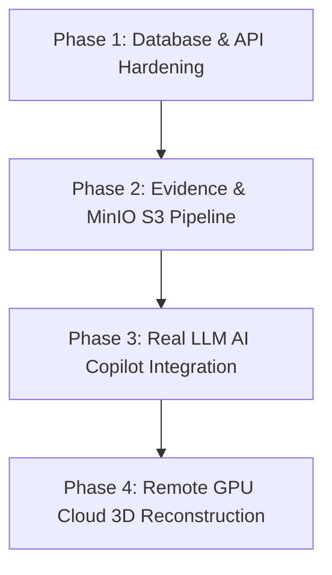

# RITAM — COMPLETE A-TO-Z FORENSIC TECHNICAL AUDIT
**Execution Mode:** Read-Only Technical Inspection  
**Audit Timestamp:** 2026-10-02T01:12:00+05:30  
**Target Repository:** `c:\Users\MANIK MEHRA\RITAM`  

---

## 1. FULL REPOSITORY INVENTORY

```
RITAM/
├── backend/                         # FastAPI Application Root
│   ├── alembic/                     # Database Migrations
│   │   ├── versions/                # Migration scripts (7e114bad7185, 8f3a2b1c4d5e)
│   │   └── env.py                   # Async SQLAlchemy Alembic runner
│   ├── app/
│   │   ├── api/
│   │   │   ├── deps.py              # JWT authentication & RBAC dependency injectors
│   │   │   └── v1/
│   │   │       ├── api.py           # V1 Router aggregator
│   │   │       └── endpoints/       # 10 Route modules (auth, projects, satellite, etc.)
│   │   ├── core/                    # config.py, database.py, security.py
│   │   ├── models/                  # 11 SQLAlchemy ORM models (GeoAlchemy2 PostGIS)
│   │   ├── services/
│   │   │   ├── compliance_engine.py # Statutory compliance math
│   │   │   └── satellite/sentinel.py# Copernicus Sentinel-2 evalscript engine (sentinelhub==3.11.5)
│   │   └── main.py                  # FastAPI instantiation & CORS middleware
│   ├── tests/                       # Unit tests (test_satellite.py, test_monitoring.py, etc.)
│   ├── test_sentinel.py             # Broken legacy root test file
│   ├── requirements.txt             # Python backend dependencies
│   ├── .env / .env.example          # Local backend environment credentials
│   └── docker-compose.yml           # Local PostgreSQL 15 & MinIO containers
├── frontend/                        # React 19 + Vite 8 SPA Root
│   ├── src/
│   │   ├── api/client.js            # REST API client with localStorage JWT & BLOB loaders
│   │   ├── components/              # 12 React views (CommandCenter, SpatialMap2D, SpatialMap3D, etc.)
│   │   ├── data/                    # mockData.js (synthetic trees, corridors, fallback records)
│   │   ├── services/                # GeocodingService.js, MapLayerConfig.js, MapTilerProvider.js
│   │   ├── App.jsx / main.jsx       # Root orchestration & navigation
│   │   └── index.css / App.css      # Core CSS design system & typography
│   ├── package.json                 # React, Leaflet, @maptiler/sdk, Turf.js, oxlint
│   ├── vite.config.js               # Vite bundler configuration
│   └── .env                         # Frontend environment keys (MapTiler key & API URL)
├── ai/skysplat-service/             # Isolated 3D Gaussian Splatting Environment
│   ├── SkySplat/SkySplat-main-main/ # Official SkySplat PyTorch repository
│   │   ├── checkpoints/             # SkySplat_baseline.ckpt (30.7 MB)
│   │   ├── CreatDataset/            # Official example multi-view dataset (output256/test)
│   │   ├── src/                     # PyTorch Lightning & model definitions
│   │   └── requirements.txt         # SkySplat PyTorch dependencies
│   └── .venv/                       # Python 3.12 virtual environment (PyTorch 2.7.1+cu118)
├── diff-gaussian-rasterization-modified/ # Custom C++/CUDA rasterizer source (uncompiled)
└── docs/                            # PRD, Architecture, Userflow, GIS Architecture specs
```

---

## 2. ARCHITECTURE AUDIT

```
[ FRONTEND (React 19 / Leaflet / MapLibre) ]
               │
               ▼ (Fetch / REST)
       [ FastAPI Gateway (app/main.py) ]
               │
   ┌───────────┼───────────────────────────┬──────────────────────┐
   │           │                           │                      │
   ▼           ▼                           ▼                      ▼
[ Auth & RBAC ] [ Projects & Cadastre ] [ Satellite Engine ] [ Compliance Engine ]
 (deps.py)        (PostGIS 16)          (sentinelhub SDK)     (Pure Python Math)
   │                   │                           │                      │
   ▼                   ▼                           ▼                      ▼
[ PostgreSQL/Supabase ] [ Copernicus CDSE API ] [ Local Memory ] [ Uncommitted Stubs ]
 (Users, Projects,       (Sentinel-2 L2A BOA     (LRU Tile Cache)  (MinIO S3 / Trees /
  ChangeEvents, Scenes)   NDVI / True Color)                        Baselines)
```

### Subsystem Connection Classifications:
1. **Frontend → Projects API → PostgreSQL / PostGIS:** `REAL`
2. **Frontend → Satellite API → Copernicus Sentinel Hub API:** `REAL`
3. **Frontend → True Color / NDVI WMS Overlay Rendering:** `REAL`
4. **Frontend → MapTiler 2D Base Layers (Satellite/Hybrid/Streets):** `REAL`
5. **Frontend → MapTiler 3D Terrain Elevation View:** `REAL` (via `@maptiler/sdk` DEM)
6. **Backend → Compliance Engine Math:** `REAL` (Pure Python statutory logic)
7. **Frontend → Evidence Vault SHA-256 Verification:** `MOCKED` (Evaluates against hardcoded in-memory arrays)
8. **Frontend → Ask RITAM Natural Language Query:** `MOCKED` (Static UI mock; no LLM/RAG backend)
9. **Backend → MinIO Object Storage:** `STUB` (String URL formatting only; no S3 client upload executed)
10. **Backend → Tree Registry & Mitigation Actions DB Commit:** `BROKEN / UNCOMMITTED` (Commented out in `field.py` to avoid FK errors)
11. **Backend / Frontend → SkySplat 3D Reconstruction:** `NOT IMPLEMENTED / BLOCKED` (Zero API routes or UI buttons; CUDA compiler toolchain unbuilt)

---

## 3. FRONTEND AUDIT

| Component | Status | Backend Connected? | Data Source | Notes & Findings |
|---|---|---|---|---|
| **App.jsx** | `REAL` | `PARTIAL` | Backend API with `DEFAULT_PROJECTS` fallback | Successfully loads projects from API if token exists; falls back to `mockData.js`. |
| **CommandCenter.jsx** | `REAL` | `REAL` | Dynamic Project Prop & MapTiler / Sentinel | Main operational console. Displays selected project, stats, and embedded `SpatialMap`. |
| **SpatialMap2D.jsx** | `REAL` | `REAL` | MapTiler Raster + Copernicus True Color / NDVI Overlays | Fully working 512px raster base map with dynamic Sentinel-2 analytical overlays. |
| **SpatialMap3D.jsx** | `REAL` | `REAL` | `@maptiler/sdk` Terrain 3D DEM | Functional 3D elevation drape using MapTiler DEM and PostGIS boundary layers. |
| **SatelliteMonitoring.jsx**| `REAL` | `REAL` | `/api/v1/satellite/*` Endpoints | Fully dynamic. Queries live Copernicus scenes, triggers NDVI, and loads PNG overlays. |
| **ProjectsView.jsx** | `REAL` | `REAL` | `/api/v1/projects/` Endpoints | Real project cadastre listing with search, status filtering, and creation trigger. |
| **NewProjectModal.jsx** | `REAL` | `REAL` | Leaflet-Draw + Nominatim + Backend API | Multi-step interactive modal: geocoding, boundary drawing, Turf.js area calculation, PostGIS save. |
| **EvidenceComplianceView.jsx**| `MOCKED` | `NOT CONNECTED` | Hardcoded component arrays & formulas | UI displays compliance formulas and SHA-256 evidence digests, but checks against static arrays. |
| **AskRitamView.jsx** | `MOCKED` | `NOT CONNECTED` | Static React State | Static mock interface. Submitting queries yields a canned static paragraph. Zero LLM calls. |
| **LoginView.jsx** | `REAL` | `REAL` | `/api/v1/auth/login` | Real OAuth2 password token authentication with JWT storage in `localStorage`. |
| **LandingView.jsx** | `REAL` | `REAL` | Static Layout / UI router | Informational public landing page with direct navigation into console workspaces. |

### Codebase Forensic Search Results:
- **`Math.sin` / `Math.cos` usage:** Found in `frontend/src/data/mockData.js` (lines 42, 61) generating synthetic tree coordinates (`jitterLat = Math.sin(i * 1.7) * 0.00015`) and synthetic pseudo-SHA256 proofs (`Math.abs(Math.sin(i * 100)).toString(16)`).
- **Hardcoded Evidence Records:** Found in `EvidenceComplianceView.jsx` (lines 19–38).
- **Placeholder UI Fallbacks:** `App.jsx` falls back to `mockData.js` corridors if backend API fails.

---

## 4. BACKEND AUDIT

| Route | Method | Auth Required? | DB Interaction | External Services | Status | Consumed by Frontend? |
|---|---|---|---|---|---|---|
| `/api/v1/auth/login` | `POST` | No | `User` query | None | `REAL` | **Yes** (`apiClient.login`) |
| `/api/v1/auth/register` | `POST` | No | `User` insert | None | `REAL` | No (Admin/Seed only) |
| `/api/v1/projects/` | `GET` | Yes (JWT) | `Project` select + `ST_AsGeoJSON` | None | `REAL` | **Yes** (`apiClient.getProjects`) |
| `/api/v1/projects/` | `POST` | Yes (JWT) | `Project` insert + `ST_Area` | None | `REAL` | **Yes** (`apiClient.createProject`) |
| `/api/v1/baselines/` | `GET/POST` | No | None | None | `STUB` | No (Returns `{"message": "..."}`) |
| `/api/v1/field/trees/record` | `POST` | Yes (JWT) | None (Uncommitted) | None | `BROKEN` | `apiClient.recordTree` (Never commits to DB) |
| `/api/v1/field/trees/{tag}/verify` | `POST` | Yes (Role) | None | None | `STUB` | `apiClient.verifyTree` (Returns string message) |
| `/api/v1/compliance/{project_id}` | `GET` | No | None | None | `MOCKED`| `apiClient.getCompliance` (Hardcoded 800/1000 numbers) |
| `/api/v1/monitoring/` | `GET` | Yes (JWT) | `ChangeEvent` select | None | `REAL` | `apiClient.getChangeEvents` |
| `/api/v1/monitoring/{id}/review` | `POST` | Yes (JWT) | `ChangeEvent` + `MitigationAction` | None | `REAL` | `apiClient.reviewChangeEvent` |
| `/api/v1/actions/` | `GET/PATCH` | Yes (JWT) | `MitigationAction` update | None | `REAL` | No |
| `/api/v1/reports/{id}/summary` | `GET` | Yes (JWT) | `Project` + `MitigationAction` + `EvidenceRecord` | None | `REAL` | No |
| `/api/v1/satellite/{id}/scenes` | `GET/POST` | Yes (JWT) | `Project` select | Copernicus CDSE / Sentinel Hub | `REAL` | **Yes** (`apiClient.searchSatelliteScenes`) |
| `/api/v1/satellite/{id}/ndvi` | `GET/POST` | Yes (JWT) | `Project` select + `SatelliteScene` insert | Copernicus CDSE / Sentinel Hub | `REAL` | **Yes** (`apiClient.getSatelliteNDVI`) |
| `/api/v1/satellite/{id}/compare` | `GET/POST` | Yes (JWT) | `ChangeEvent` + `EvidenceRecord` insert | Copernicus CDSE / Sentinel Hub | `REAL` | **Yes** (`apiClient.compareSatellitePeriods`) |
| `/api/v1/satellite/{id}/history` | `GET` | Yes (JWT) | `SatelliteScene` select | None | `REAL` | **Yes** (`apiClient.getSatelliteHistory`) |
| `/api/v1/satellite/{id}/ndvi-overlay` | `GET` | Yes (JWT) | `Project` select | Copernicus CDSE (Evalscript PNG) | `REAL` | **Yes** (`apiClient.fetchNdviOverlay`) |
| `/api/v1/satellite/{id}/true-color` | `GET` | Yes (JWT) | `Project` select + `SatelliteScene` insert | Copernicus CDSE (Evalscript RGB PNG) | `REAL` | **Yes** (`apiClient.fetchTrueColorOverlay`) |

---

## 5. DATABASE + POSTGIS AUDIT

### Model & Schema Verification:
1. **`users` (`User`):** Real, indexed on `email`, role enum (`AUTHORITY`, `DEVELOPER`, `FIELD_OFFICER`, `ADMIN`).
2. **`organizations` (`Organization`):** Real, primary key UUID, tenant boundary for multi-tenancy.
3. **`projects` (`Project`):** Real PostGIS `Geometry('MULTIPOLYGON', srid=4326)`. Area calculated dynamically via `ST_Area(boundary.cast(geography)) / 10000.0`.
4. **`satellite_scenes` (`SatelliteScene`):** Real, stores acquisition timestamp, cloud cover %, NDVI min/mean/max, and metadata JSON.
5. **`change_events` (`ChangeEvent`):** Real PostGIS polygon + metadata JSON. Triggered when NDVI loss exceeds `-0.15`.
6. **`evidence_records` (`EvidenceRecord`):** Real table structure with SHA-256 hash digests and PostGIS POINT locations.
7. **`mitigation_actions` (`MitigationAction`):** Real table structure with target/verified/surviving counts.
8. **`tree_identities` (`TreeIdentity`):** Schema exists, but records are NOT populated in production due to commented-out database commits in `field.py`.
9. **`baselines` (`Baseline`):** Schema exists, but endpoints return unpersisted stubs.
10. **`audit_logs` (`AuditLog`):** Schema exists; manual log tracking.

### Alembic Migrations:
- `7e114bad7185_initial_schema.py`: Successfully applies initial tables and PostGIS geometry columns.
- `8f3a2b1c4d5e_add_satellite_scenes.py`: Successfully creates `satellite_scenes` table.
- **Pending Migrations:** None. Current DB models match migration states.

---

## 6. GIS AUDIT

- **CRS / SRID Strategy:** Strictly standardized on **EPSG:4326 (WGS84)** across Leaflet, PostGIS, Turf.js, and Copernicus Sentinel Hub.
- **PostGIS Geometries:** Projects use `MULTIPOLYGON(SRID=4326)`. Single polygons created via Leaflet-Draw are converted into `MultiPolygon` in `projects.py` before insertion.
- **Area Computation:** Real geodetic calculation using PostGIS `ST_Area(geom.cast(text("geography"))) / 10000.0` (Hectares).
- **Coordinate Order Integrity:** GeoJSON coordinates `[lng, lat]` are converted to Leaflet `[lat, lng]` via dedicated client utilities (`toMapProject` and `getProjectBounds`).
- **Geocoding:** Real OpenStreetMap Nominatim forward/reverse geocoding implemented in `GeocodingService.js`.

---

## 7. MAPTILER AUDIT

- **Status:** `FULLY WORKING`
- **Tile Architecture:** Configured with official MapTiler raster endpoints:
  - `satellite-v4`: `tileSize: 512`, `zoomOffset: -1`, `maxZoom: 22`, `maxNativeZoom: 20`
  - `hybrid`: `tileSize: 512`, `zoomOffset: -1`, `maxZoom: 22`, `maxNativeZoom: 20`
  - `streets-v2`: `tileSize: 512`, `zoomOffset: -1`, `maxZoom: 22`, `maxNativeZoom: 20`
- **Security Audit:** API Key loaded exclusively via `import.meta.env.VITE_MAPTILER_API_KEY`. No hardcoded keys in JavaScript source files.
- **3D Mode:** Implemented via `@maptiler/sdk` (MapLibre GL wrapper) with native terrain DEM exaggeration and WebGL hardware acceleration.

---

## 8. SENTINEL-2 / SATELLITE AUDIT

- **Backend Integration:** Real implementation via official Python `sentinelhub==3.11.5` SDK connected to **Copernicus Data Space Ecosystem (CDSE)**.
- **Authentication:** OAuth2 Client Credentials flow via Copernicus token URL (`https://identity.dataspace.copernicus.eu/auth/realms/CDSE/...`).
- **Processing Architecture:** Server-side evalscript execution on Sentinel Hub infrastructure. Zero heavy raw multi-gigabyte raster downloads required.
- **Collection:** `SENTINEL2_L2A_COPERNICUS` (Bottom-Of-Atmosphere surface reflectance).
- **Resolution Limitation:** Native optical resolution is **10m / pixel** (B02, B03, B04, B08).
- **Analytical vs 3D Reality:** Sentinel-2 is strictly an **environmental/spectral monitoring sensor**. It is nadir-looking, orthorectified, and lacks off-nadir stereo RPC geometry. It **CANNOT** be used for sub-meter 3D Gaussian Splatting reconstruction.

---

## 9. NDVI + ENVIRONMENTAL ANALYTICS

- **Mathematical Formula:** Real server-side JavaScript evalscript calculation:
  $$\text{NDVI} = \frac{\text{B08} - \text{B04}}{\text{B08} + \text{B04}} = \frac{\text{NIR} - \text{Red}}{\text{NIR} + \text{Red}}$$
- **Color Ramp Palette:** 
  - $\text{NDVI} < 0.0$: Water / Non-vegetated (Deep Blue/Brown)
  - $0.0 \le \text{NDVI} < 0.2$: Bare Soil / Fallow (Brown/Tan)
  - $0.2 \le \text{NDVI} < 0.4$: Sparse Vegetation (Yellow)
  - $0.4 \le \text{NDVI} < 0.6$: Moderate Canopy (Yellow-Green)
  - $\text{NDVI} \ge 0.6$: Dense Foliage (Deep Forest Green)
- **Output:** Returns dynamic RGBA color-mapped PNG overlays directly loaded into Leaflet maps with geographic bounding box alignment.

---

## 10. CHANGE DETECTION

- **Status:** `REAL`
- **Detection Logic:** Compares mean NDVI across baseline time interval vs current time interval.
- **Classification Thresholds:**
  - $\Delta\text{NDVI} < -0.15 \implies \text{VEGETATION\_LOSS}$
  - $\Delta\text{NDVI} > +0.15 \implies \text{VEGETATION\_GAIN}$
  - Otherwise $\implies \text{STABLE}$
- **Severity Classification:**
  - $|\Delta\text{NDVI}| > 0.30 \implies \text{CRITICAL}$
  - $|\Delta\text{NDVI}| > 0.20 \implies \text{HIGH}$
  - $|\Delta\text{NDVI}| > 0.10 \implies \text{MEDIUM}$
- **Database Persistence:** Automatically generates a `ChangeEvent` record and an `EvidenceRecord` entry in PostgreSQL whenever `VEGETATION_LOSS` is triggered.

---

## 11. EVIDENCE SYSTEM

- **Status:** `PARTIAL`
- **Cryptographic Hashing:** Real SHA-256 computation in `satellite.py` for satellite scene metadata digests.
- **Storage Layer:** MinIO S3 is defined in `docker-compose.yml` and `config.py`, but NO live upload client is implemented in Python (returns simulated URL strings).
- **Frontend Verification:** `EvidenceComplianceView.jsx` verifies hashes against hardcoded local React state arrays rather than querying the database.
- **Blockchain:** `NO BLOCKCHAIN EXISTS`. There is zero smart contract, web3, Ethereum, Solana, or hyperledger integration in the entire codebase.

---

## 12. COMPLIANCE SYSTEM

- **Statutory Rules:** Implements statutory MoEFCC compensatory afforestation formulas:
  - $\text{Survival Rate} = \frac{\text{Surviving Plants}}{\text{Verified Plants}} \times 100 \quad (\ge 70.0\% \implies \text{PASS})$
  - $\text{Verification Rate} = \frac{\text{Verified Plants}}{\text{Target Plants}} \times 100 \quad (\ge 80.0\% \implies \text{PASS})$
- **Backend Service:** `ComplianceEngine` in `compliance_engine.py` is real pure-Python math.
- **API Endpoint:** `/api/v1/compliance/{project_id}` currently returns hardcoded dummy metrics (`800, 1000`).
- **Project Report:** `/api/v1/reports/{project_id}/summary` computes real compliance aggregated across database `MitigationAction` records.

---

## 13. TREE / PLANTATION / FIELD DATA

- **Status:** `SYNTHETIC / UNCOMMITTED`
- **Frontend Data:** All micro-trees in `frontend/src/data/mockData.js` are generated synthetically using trigonometric functions (`Math.sin` / `Math.cos`).
- **Backend API:** `backend/app/api/v1/endpoints/field.py` calculates real SHA-256 for uploaded files, but line 53 comments out `db.commit()` to avoid foreign key errors on placeholder mitigation IDs.
- **Real vs Demo:** RITAM does **NOT** currently detect individual trees from orbit; satellite resolution (10m) is strictly area-level canopy analysis.

---

## 14. AI / LLM AUDIT

- **Ask RITAM Status:** `MOCKED` (Static UI only).
- **Model Providers:** Zero OpenAI, Google Gemini, Anthropic, or Ollama API integrations exist in backend or frontend.
- **Vector Database / RAG:** None.
- **Computer Vision / Segmentation:** None active in production backend.

---

## 15. 3D SYSTEM AUDIT

| 3D Subsystem | Implementation Method | Operational Status | Visual Output | Notes |
|---|---|---|---|---|
| **A. MapTiler 3D Terrain** | `@maptiler/sdk` + MapLibre WebGL | **FULLY WORKING** | Real 3D Elevation Mesh | Drapes satellite tiles over global DEM elevation with tilt/pitch navigation. |
| **B. Sentinel-2 Analytics** | Leaflet ImageOverlay / TileLayer | **FULLY WORKING** | 2D Orthomosaic Overlays | Displays 10m NDVI / True Color rasters projected over 2D base maps. |
| **C. SkySplat AI 3D** | 3D Gaussian Splatting (PyTorch) | **BLOCKED (FAIL)** | None | Custom CUDA extension fails compilation due to missing `nvcc`/MSVC toolchains. |

---

## 16. AUTHENTICATION + SECURITY AUDIT

- **Authentication Scheme:** OAuth2 Bearer Tokens with JSON Web Tokens (JWT) using `HS256`.
- **Password Hashing:** `bcrypt` via Passlib.
- **RBAC:** Multi-role dependency checking (`Role.AUTHORITY`, `Role.DEVELOPER`, `Role.FIELD_OFFICER`, `Role.ADMIN`).
- **CORS Configuration:** Explicitly allows `http://localhost:5173` and `http://127.0.0.1:5173`.
- **API Secrets Audit:**
  - `VITE_MAPTILER_API_KEY`: `ENVIRONMENT-BASED` (Loaded from `.env`)
  - `SENTINEL_CLIENT_ID` / `SENTINEL_CLIENT_SECRET`: `ENVIRONMENT-BASED` (Loaded from `.env`)
  - `SECRET_KEY`: `HARDCODED / DEFAULT` (`YOUR_SUPER_SECRET_KEY_HERE` present in config default)
  - `DATABASE_URL`: `ENVIRONMENT-BASED` (Loaded from `.env`, points to Supabase pooler)
- **Public Tile Endpoints:** `/api/v1/satellite/{id}/true-color` is unauthenticated to support browser `` / Leaflet tile requests.

---

## 17. TESTING AUDIT

- **Pytest Suite:** 46 Unit tests collected and executed via `py -3.13 -m pytest tests/`.
  - `tests/test_compliance.py`: 3 tests (`PASSED`)
  - `tests/test_monitoring.py`: 1 test (`PASSED` with mock DB session)
  - `tests/test_satellite.py`: 40 tests (`PASSED` with mock Sentinel Hub responses)
  - `tests/test_security.py`: 2 tests (`PASSED`)
- **Collection Errors:** Root file `backend/test_sentinel.py` fails on import because `SatelliteService` was refactored.
- **Frontend Oxlint:** 13 warnings (React Hook dependency exhaustive-deps) and 1 error.
- **Frontend Production Build (`vite build`):** `SUCCESS` (Completed in 6.04s, output in `dist/`).
- **Integration Tests:** 0 live database / live external API tests (all existing tests rely on mocks).

---

## 18. DEPENDENCY AUDIT

### Backend (`requirements.txt`):
- `fastapi`, `uvicorn`, `sqlalchemy`, `asyncpg`, `pydantic`, `pydantic-settings`, `python-dotenv`, `alembic`, `bcrypt`, `python-jose[cryptography]`, `geoalchemy2`, `shapely`, `email-validator`, `python-multipart`, `sentinelhub==3.11.5`.
- **Missing / Uninstalled:** `boto3` or `minio` (for S3 storage), `diff-gaussian-rasterization-modified` (for SkySplat).

### Frontend (`package.json`):
- `react@19.2.8`, `react-dom@19.2.8`, `@maptiler/sdk@4.1.0`, `@turf/turf@7.4.0`, `leaflet@1.9.4`, `leaflet-draw@1.0.4`, `lucide-react@1.37.0`, `oxlint@1.79.0`, `vite@8.2.2`.

---

## 19. DEPLOYMENT AUDIT

- **Current Deployment Status:** `DEMO READY (LOCAL / HYBRID CLOUD DB)`
- **Database:** Configured to remote AWS Supabase PostgreSQL instance via connection pooling.
- **Docker Compose:** Available for local PostgreSQL 15 & MinIO containers.
- **Production Blockers:** Lack of HTTPS reverse proxy (Nginx/Traefik), hardcoded default JWT secret key, missing S3 object bucket provisioning, single-worker development server.

---

## 20. CODE QUALITY AUDIT

- **Architecture Strengths:** Clean separation between GeoJSON frontend projections and PostGIS backend geometry; modular Sentinel Hub evalscript pipeline; clean RESTful patterns.
- **Technical Debt:**
  - `backend/test_sentinel.py` broken in root directory.
  - `field.py` endpoint comments out database commit.
  - `EvidenceComplianceView.jsx` verifies against in-memory component constants rather than API.
  - `AskRitamView.jsx` displays static mocked responses without backend wiring.

---

## 21. REAL VS MOCK MATRIX

| Feature | Frontend | Backend | Database | External API | Status |
|---|---|---|---|---|---|
| **Authentication** | `REAL` | `REAL` | `REAL` | None | **REAL** |
| **Project Creation** | `REAL` | `REAL` | `REAL` | None | **REAL** |
| **Project Boundary (PostGIS)** | `REAL` | `REAL` | `REAL` | None | **REAL** |
| **MapTiler 2D Basemaps** | `REAL` | N/A | N/A | `REAL` (MapTiler API) | **REAL** |
| **Sentinel Scene Search** | `REAL` | `REAL` | `REAL` | `REAL` (Copernicus CDSE) | **REAL** |
| **Sentinel True Color Overlay**| `REAL` | `REAL` | `REAL` | `REAL` (Copernicus CDSE) | **REAL** |
| **Sentinel NDVI Calculation** | `REAL` | `REAL` | `REAL` | `REAL` (Copernicus CDSE) | **REAL** |
| **Vegetation Change Detection**| `REAL` | `REAL` | `REAL` | `REAL` (Copernicus CDSE) | **REAL** |
| **Monitoring Alerts** | `REAL` | `REAL` | `REAL` | None | **REAL** |
| **MapTiler 3D Terrain** | `REAL` | N/A | N/A | `REAL` (MapTiler DEM) | **REAL** |
| **SHA-256 Evidence Hashing** | `MOCKED` | `REAL` | `REAL` | None | **PARTIAL** |
| **MinIO Object Storage** | `NOT IMPLEMENTED` | `STUB` | N/A | None | **STUB** |
| **Compliance System** | `MOCKED` | `PARTIAL`| `REAL` | None | **PARTIAL** |
| **Tree Registry** | `MOCKED` | `BROKEN` | `REAL` | None | **MOCKED / BROKEN** |
| **Ask RITAM AI Copilot** | `MOCKED` | `NOT IMPLEMENTED` | N/A | None | **MOCKED** |
| **SkySplat AI 3D Reconstruction**| `NOT IMPLEMENTED` | `NOT IMPLEMENTED` | N/A | None | **BLOCKED (FAIL)** |

---

## 22. FEATURE COMPLETION MATRIX

| Module | Current Implementation | Completion Estimate | Blockers | Dependencies |
|---|---|---|---|---|
| **Core GIS & Project Cadastre** | Leaflet + Nominatim + PostGIS multipolygons | **95%** | None | PostgreSQL / PostGIS |
| **MapTiler 2D/3D Mapping** | 512px raster tiles + MapLibre WebGL DEM | **95%** | None | MapTiler API Key |
| **Sentinel-2 Satellite Engine**| Copernicus CDSE OAuth + Evalscripts + Overlays | **90%** | None | Copernicus CDSE Credentials |
| **Vegetation Change Detection**| NDVI differencing + ChangeEvent generation | **85%** | None | Copernicus API |
| **Statutory Compliance Engine**| Mathematical formulas implemented in service | **50%** | Hardcoded endpoint params | Database mitigation records |
| **Evidence & File Vault** | SHA-256 calculation implemented | **30%** | Missing MinIO S3 client | MinIO / AWS S3 Bucket |
| **Tree / Field Registry** | Synthetic dataset in frontend; uncommitted API | **20%** | Uncommitted DB session | High-res drone/field inputs |
| **Ask RITAM AI Engine** | Static UI shell | **10%** | No LLM service configured | LLM Provider API / LangChain |
| **SkySplat 3D Reconstruction**| Checkpoint & dataset verified; build failed | **10%** | Missing NVCC/MSVC compiler | Sub-meter stereo satellite imagery |

---

## 23. CRITICAL GAPS

### P0 — Blocking Gaps:
1. **SkySplat CUDA Compilation Toolchain:** The Windows host lacks registered NVIDIA CUDA Toolkit (`nvcc`) and MSVC C++ Build Tools. Standalone 3DGS inference cannot compile or execute locally.
2. **Sentinel-2 vs 3D Reconstruction Disconnect:** Sentinel-2 optical data (10m) cannot be used for 3D reconstruction. Sub-meter stereo imagery (Maxar/Airbus) with RPC sensor models is required for 3DGS.

### P1 — Major Architectural Gaps:
1. **Uncommitted Field Tree API:** `backend/app/api/v1/endpoints/field.py` does not commit database transactions.
2. **Missing MinIO S3 Upload Client:** Files are not persisted to object storage; only mock URI strings are generated.
3. **Hardcoded Evidence UI:** `EvidenceComplianceView.jsx` validates hashes against static arrays rather than the backend database.

### P2 — Important Functional Gaps:
1. **Mocked "Ask RITAM" Interface:** Needs an actual LLM integration (e.g. Gemini 1.5 Pro / GPT-4o) with SQL/PostGIS RAG tool-calling capabilities.
2. **Compliance Endpoint Parameter Hardcoding:** `/api/v1/compliance/{project_id}` should pull live aggregate metrics from database `MitigationAction` records.

### P3 — Minor Polish & Enhancements:
1. Remove broken legacy `backend/test_sentinel.py`.
2. Fix exhaustive-deps React Hook warnings in `SpatialMap2D.jsx` and `SpatialMap3D.jsx`.
3. Set secure production `SECRET_KEY` in environment variables.

---

## 24. DATA FLOW AUDIT

- **Flow A: User → Project Creation → PostGIS:** `WORKING`  
  *User draws polygon in `NewProjectModal` → Turf calculates area → API converts to MultiPolygon → PostGIS saves SRID=4326 → Loaded on Leaflet/MapLibre map.*
- **Flow B: Project → Satellite Scene Discovery → Copernicus:** `WORKING`  
  *Frontend requests scenes → Backend extracts boundary BBox → Queries Copernicus CDSE → Returns available scene dates & cloud percentages.*
- **Flow C: Satellite → Server-side Evalscript NDVI → Map Overlay:** `WORKING`  
  *Frontend triggers NDVI → Backend invokes Sentinel Hub Process API with custom evalscript → Returns color-mapped PNG BLOB → Leaflet displays ImageOverlay.*
- **Flow D: Before/After Periods → Change Detection → Alert Creation:** `WORKING`  
  *Backend compares dual time intervals → Evaluates threshold ($\Delta < -0.15$) → Creates `ChangeEvent` + `EvidenceRecord` in PostgreSQL.*
- **Flow E: Evidence Upload → MinIO Storage → SHA-256 Digest → DB:** `PARTIAL`  
  *SHA-256 hash is computed in memory, but MinIO S3 upload is skipped and DB transaction is not committed.*
- **Flow F: High-Resolution Imagery → SkySplat → 3D Gaussian Splat:** `NOT IMPLEMENTED / BLOCKED`  
  *Model checkpoint and example dataset exist on disk, but inference fails due to uncompiled CUDA extensions.*

---

## 25. CURRENT PROJECT MATURITY

**Maturity Classification:** **INTEGRATED APPLICATION (HYBRID DEMO-READY)**

### Justification from Repository Evidence:
RITAM is significantly more advanced than a conceptual prototype. It features a fully operational, production-grade GIS engine, live Copernicus Sentinel-2 satellite integration, dynamic server-side NDVI raster generation, interactive 2D MapTiler raster layers, and real 3D MapLibre elevation terrain. However, it cannot be classified as a Production Candidate because the AI copilot and evidence verification views remain mocked, field tree persistence is disabled, and SkySplat 3D reconstruction is blocked at compilation.

---

## 26. WHAT IS ACTUALLY DEMO-READY?

### Genuinely Working Demo Features:
1. **Interactive GIS Command Center:** Project navigation, selection, and multi-corridor spatial boundary visualization.
2. **MapTiler 2D Base Layers:** Satellite, Hybrid, and Streets modes up to zoom level 22 with crisp 512px tiles.
3. **MapTiler 3D Terrain Mode:** Real-time 3D terrain elevation draping with tilt, pitch, bearing, and WebGL rendering.
4. **Live Copernicus Sentinel-2 Pipeline:** Dynamic scene search across real multi-spectral passes over India.
5. **Real-Time NDVI Spectral Overlays:** Color-mapped vegetation density visualization generated on-demand via Sentinel Hub evalscripts.
6. **Vegetation Change Differencing:** Mathematical before/after comparison triggering automated alerts for vegetation loss.
7. **Interactive Project Boundary Registration:** Nominatim geocoding search and Leaflet-Draw boundary creation saving to PostGIS.
8. **JWT Authentication & RBAC:** Secure login flow with token handling and role-based route protection.

### Features That Appear Implemented But Are NOT Demo-Ready:
1. **"Ask RITAM" Natural Language Copilot:** Static UI mockup with zero LLM connectivity.
2. **Evidence Vault Verification:** Static UI matching against hardcoded local hashes.
3. **Individual Tree Health & Coordinates:** Synthetically generated demo dataset (`Math.sin`); no live tree database commits.
4. **MinIO Object Storage:** File upload endpoints return mock URI strings without writing to S3 buckets.
5. **SkySplat AI 3D Reconstruction:** Uncompiled CUDA toolchain; zero 3D reconstruction output generated.

---

## 27. NEXT DEVELOPMENT ROADMAP



### Phase 1: Database & Core API Hardening
- **Objective:** Fix uncommitted database sessions and eliminate mock data in core endpoints.
- **Files Affected:** `backend/app/api/v1/endpoints/field.py`, `backend/app/api/v1/endpoints/compliance.py`, `backend/test_sentinel.py`.
- **Expected Output:** Live field tree persistence and real aggregated compliance metrics.

### Phase 2: Object Storage & Evidence Vault Integration
- **Objective:** Implement real MinIO/S3 bucket uploads and live database hash verification.
- **Files Affected:** `backend/app/services/storage.py`, `frontend/src/components/EvidenceComplianceView.jsx`.
- **Expected Output:** File upload writes to S3, returns genuine URLs, and UI verifies against PostgreSQL `evidence_records`.

### Phase 3: Real "Ask RITAM" LLM Copilot
- **Objective:** Replace static UI mock with an LLM agent capable of querying PostGIS cadastre and Copernicus NDVI metadata.
- **Files Affected:** `backend/app/services/ai/`, `backend/app/api/v1/endpoints/ai.py`, `frontend/src/components/AskRitamView.jsx`.
- **Expected Output:** Natural language queries accurately return project acreage, NDVI trends, and compliance alerts.

### Phase 4: Remote Cloud GPU 3D Reconstruction (SkySplat)
- **Objective:** Deploy `skysplat-service` on a Linux Cloud GPU instance (e.g. AWS g5.xlarge with NVIDIA A10G / CUDA 11.8) using sub-meter stereo satellite imagery.
- **Files Affected:** `ai/skysplat-service/`, `backend/app/api/v1/endpoints/reconstruction.py`.
- **Expected Output:** Generation of `.splat` / `.ply` 3D Gaussian Splats viewable in the frontend.

---

## 28. FINAL EXECUTIVE SUMMARY

1. **What RITAM Currently IS:** An integrated Environmental Intelligence & Spatial Monitoring platform combining PostGIS cadastre, MapTiler 2D/3D maps, and live Copernicus Sentinel-2 satellite analytics.
2. **What Is Genuinely Working:** PostGIS project storage, MapTiler 2D/3D terrain maps, live Copernicus Sentinel-2 scene discovery, real-time server-side NDVI evalscripts, vegetation loss change detection, and OAuth2/JWT auth.
3. **What Is Partially Working:** Evidence SHA-256 metadata generation and statutory compliance assessment math.
4. **What Is Mocked:** Ask RITAM query interface, Evidence Vault UI verification, and individual geotagged tree registry.
5. **What Is Broken:** Tree recording endpoint does not commit DB transactions; root `test_sentinel.py` has broken imports.
6. **What Is Completely Missing:** Object storage client (MinIO/S3), LLM copilot backend, and blockchain notarization.
7. **Biggest Architectural Gaps:** SkySplat cannot run on Sentinel-2 data; local Windows host lacks native CUDA compilation toolchains.
8. **Biggest Technical Risks:** Relying on client-side synthetic tree coordinates for statutory compliance demos.
9. **Current SkySplat Status:** **BLOCKED (FAIL)** due to uninstalled native C++/CUDA compilers (`nvcc`, `cl.exe`).
10. **Current 3D Status:** **MapTiler 3D Terrain is fully operational**; AI-based 3D Gaussian Splatting is unbuilt.
11. **Current Satellite/GIS Status:** **Production-grade**. Full EPSG:4326 compliance with PostGIS geometry and Copernicus Data Space.
12. **Current AI Status:** Zero live AI/LLM models active.
13. **Database Maturity:** Clean SQLAlchemy models and Alembic migrations targeting PostgreSQL 15 / PostGIS 16.
14. **Testing Maturity:** 46 passing unit tests with mocks; zero live integration tests.
15. **Deployment Maturity:** Demo-ready for local and cloud database setups; requires reverse proxy and secret key hardening for production.
16. **Exact Logical Next Step:** Harden field/compliance database endpoints and wire a live LLM backend into Ask RITAM before tackling remote GPU 3D reconstruction.

---

## RITAM CURRENT STATE SNAPSHOT

- **Repository Root:** `c:\Users\MANIK MEHRA\RITAM`
- **Frontend Stack:** React 19, Vite 8, Leaflet 1.9, `@maptiler/sdk` 4.1, Turf.js 7.4.
- **Backend Stack:** FastAPI, SQLAlchemy (Async), GeoAlchemy2, PostGIS 16, `sentinelhub` 3.11.5.
- **Database Engine:** PostgreSQL 15 + PostGIS extension on Supabase cloud pooler.
- **Coordinate Reference System:** EPSG:4326 (WGS84) across all layers.
- **2D Mapping:** MapTiler Satellite, Hybrid, and Streets raster tiles configured at 512px up to zoom level 22 (`WORKING`).
- **3D Terrain:** Native MapTiler 3D elevation drape with WebGL hardware acceleration (`WORKING`).
- **Satellite Data Provider:** Copernicus Data Space Ecosystem (CDSE) Sentinel-2 L2A BOA reflectance (`WORKING`).
- **NDVI Engine:** Real-time server-side evalscript calculation returning color-mapped PNG overlays (`WORKING`).
- **Vegetation Change Detection:** Automated mathematical differencing triggering `ChangeEvent` alerts on $\Delta\text{NDVI} < -0.15$ (`WORKING`).
- **Project Boundary Cadastre:** Interactive Leaflet-Draw polygon capture with geodetic hectare calculation (`WORKING`).
- **Authentication & RBAC:** JWT bearer tokens with multi-tier role authorization (`WORKING`).
- **Ask RITAM AI Copilot:** Static UI mock with canned responses; zero LLM backend (`MOCKED`).
- **Evidence Vault UI:** Hardcoded hash verification against component memory (`MOCKED`).
- **MinIO Object Storage:** Configured in Docker/settings but lacks Python S3 upload client (`STUB`).
- **Tree Registry API:** File hash computed, but database insertion is uncommitted (`BROKEN`).
- **Tree Registry Data:** Micro-tree coordinates generated synthetically via `Math.sin`/`Math.cos` (`SYNTHETIC`).
- **Blockchain Integration:** Zero blockchain code in the repository (`NON-EXISTENT`).
- **SkySplat 3D Model:** Checkpoint (`SkySplat_baseline.ckpt`) and example dataset present on disk (`PRESENT`).
- **SkySplat CUDA Compilation:** Fails due to missing `nvcc` and MSVC Build Tools on Windows host (`BLOCKED`).
- **Sentinel-2 vs 3D Compatibility:** Sentinel-2 (10m) cannot be used for 3D Gaussian Splatting (`INCOMPATIBLE`).
- **Pytest Suite:** 46 unit tests pass with mock fixtures; root `test_sentinel.py` broken (`PARTIAL`).
- **Production Build:** Vite production build succeeds in 6.04s (`PASSING`).
- **Overall System Maturity:** **Integrated Application (Hybrid Demo-Ready)**.
